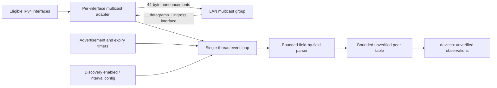
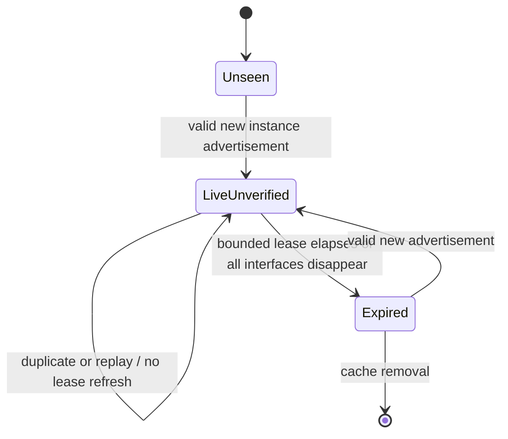

# ADR 0003: Proposed UDP LAN discovery

## Status

Proposed for review. Design only; no UDP discovery code is implemented.

## Context

LinkOS needs to show other running instances on a local network without implying
that discovery establishes identity, trust, or permission. The M2 TCP API is a
single-threaded, bounded event-loop API. Discovery must fit that ownership model,
remain small in C17, and leave room for IPv6 without putting native addresses in
the protocol.

## Options considered

| Design | Benefits | Costs and risks |
|---|---|---|
| IPv4 subnet broadcast | Familiar LAN behavior; no group membership | Requires correct per-interface broadcast calculation; routers and Wi-Fi isolation often suppress it; IPv4-only semantics |
| IPv4 multicast per interface | One group/port, no subnet mask math, receiver can identify ingress interface, maps naturally to IPv6 multicast later | Multicast can be blocked or disabled on consumer/AP networks; interface membership and packet-info APIs are platform-specific |
| mDNS/DNS-SD | Established service-discovery convention and mature implementations | Adds dependency or OS service integration, packaging and interoperability decisions; instance naming and record lifecycle are broader than LinkOS needs |

## Decision proposed

Use a small IPv4 multicast discovery service in the existing event loop. Join the
same product-selected administratively scoped group on each eligible interface;
send an advertisement separately over each interface. Set multicast TTL to 1,
disable multicast loopback for outbound advertisements where supported, and
receive with packet information enabled so each record is associated with its
ingress interface. Select and document the actual group and UDP port before
implementation. This is a LAN hint, not a security boundary; TTL and multicast
scope do not guarantee containment on every network. IPv6 can later add an
IPv6-specific group and address family behind the same discovery message/parser
and interface abstraction.

The event loop owns the UDP socket(s), membership list, timers, and peer table.
Do not add a worker thread or dependency. Discovery must not block the TCP loop;
datagrams are consumed with a bounded per-tick budget. Socket operations stay
inside a private discovery adapter; the protocol parser receives bytes and
metadata only.

M3 should extend the existing opaque `linkos_net_socket_t` handle to represent
either a TCP stream or UDP datagram endpoint. The shared `linkos_net_poll` can
then monitor both kinds without exposing native handles or creating a second
poller. Add narrowly typed UDP operations for bind, per-interface multicast
join/leave, multicast interface selection, send-to, and receive-from with ingress
interface metadata. TCP send/receive calls must reject datagram handles and vice
versa. UDP handles count toward the same 64-handle cap and obey the same
single-thread ownership/cleanup rules. Represent endpoints with a portable
family enum, fixed 16-byte address storage, host-order port, and interface index;
do not expose `sockaddr`, `SOCKET`, or POSIX descriptors. This gives IPv6 a
future endpoint representation without implementing it in M3.

## Datagram format, version 1

All integers are unsigned big-endian. The parser decodes fields individually;
never cast packet bytes to a C structure. The sole initial message is a fixed
44-byte advertisement, with no optional or extensible tail in version 1.

| Offset | Size | Field | Rule |
|---:|---:|---|---|
| 0 | 4 | Magic `LNKD` | Exact match |
| 4 | 1 | Wire version | `1`; unknown versions are ignored |
| 5 | 1 | Message type | `1` = advertisement; other types ignored |
| 6 | 2 | Header length | `44` |
| 8 | 2 | Total length | `44`; must equal received datagram length |
| 10 | 2 | Reserved | Must be zero |
| 12 | 2 | Application protocol minimum | Inclusive version number |
| 14 | 2 | Application protocol maximum | Inclusive, must be >= minimum |
| 16 | 16 | Instance ID | Random per process run; not a persistent device identity |
| 32 | 8 | Sequence | Starts at zero and increases per advertisement for this instance |
| 40 | 2 | TCP service port | Nonzero; endpoint port only, not authenticated |
| 42 | 2 | Lease seconds | Sender's requested expiry, bounded to 5..180 |

The datagram is exactly 44 bytes; receive buffers should be at least 45 bytes so
oversized/truncated packets can be rejected. Version 1 has no hostname, display
name, IP address, filesystem path, operating-system details, capabilities, or
secret. Future fields require a new wire version with explicit compatibility
rules. The application protocol range is separate from the discovery wire
version. A receiver marks overlap as compatible, otherwise marks the peer
incompatible; neither state authorizes a connection.

## Identity and duplicate advertisements

Key a running peer record by the 128-bit random instance ID, never by IP address.
Generate it with the operating system CSPRNG when the discovery service starts
(for example, `getrandom` on Linux and `BCryptGenRandom` on Windows). If secure
random bytes are unavailable, fail discovery startup; do not fall back to a
time-seeded or custom generator. Rotate it
on process restart; this reduces cross-network tracking and ensures stale records
cannot represent a later process. The later pairing protocol must establish any
stable authenticated device identity independently. The source address and TCP
port are untrusted candidate endpoints associated with that instance and
interface.

Advertisements from the same instance and ingress interface update its endpoint
only when the sequence is newer under 64-bit serial-number arithmetic. Equal or
older sequence values are duplicates/replays and do not extend the lease. Merge
records with the same instance ID heard on multiple local interfaces. If the same
instance ID appears with contradictory protocol ranges/ports across interfaces,
keep separate endpoint observations and surface conflict state; do not silently
choose identity from an address. A forged higher sequence remains possible.

## Lifecycle and network interfaces

On startup, enumerate UP, non-loopback IPv4 interfaces with a usable multicast
route. Join on each and send an initial advertisement, then advertise every 5
seconds by default with small per-instance jitter. Permit a validated configured
interval from 1 to 60 seconds; publish a lease of three intervals plus a small
grace, clamped to 5..180 seconds. Receivers clamp all accepted leases to the same
5..180 second range and expire peers by monotonic receive time. Duplicate packets
do not refresh expiry.

Re-enumerate interfaces periodically and on native change notifications where
available. Treat interface index plus local IPv4 address/prefix as an interface
generation. On address/route change, leave old memberships, join new eligible
interfaces, and discard endpoints learned only through the removed generation.
Keep a peer visible while another live interface endpoint remains; otherwise
mark it expired/remove it. Network switches must not preserve old endpoints as
connectable candidates. Interface enumeration or membership failure is local to
that interface; continue with other interfaces and expose a concise diagnostic.

Discovery defaults to enabled only when the user has enabled networking; provide
`discovery.enabled` and `discovery.interval_seconds` settings. Disabling discovery
leaves multicast memberships, stops sends, closes the UDP socket, and clears the
unverified cache. Re-enabling starts a fresh process-local discovery instance.

## Bounds and error handling

- Maximum datagram: 44 bytes accepted; receive into 45 bytes and reject any other length.
- Maximum peer records: 256; maximum endpoint observations per peer: 8.
- No allocation based on wire lengths. Parse into fixed-width local fields, then
  insert/update only if limits permit.
- Rate-limit accepted advertisements globally and per source/interface. Drop
  malformed, unknown-version, unknown-type, zero-port, bad-range, reserved-bit,
  oversized, and over-rate datagrams without logging packet contents.
- Peer-table exhaustion does not evict a live record based on unauthenticated
  input; reject new records and count a bounded diagnostic metric.
- Retry transient interface/socket errors with bounded backoff. A failed
  interface does not tear down other interfaces. Stop/disable closes all sockets
  and drops memberships before releasing interface state.

## Security analysis and limits

Discovery never establishes trust. Treat every datagram and endpoint as attacker
controlled. A receiver may display a peer as **unverified** but must not
automatically connect, pair, browse, or authorize file access based on it. Never
broadcast authentication secrets, stable identifiers, filesystem paths, host
names, or arbitrary machine information. Do not add custom cryptography.

Random instance IDs and sequence numbers reduce accidental collision and stale
replay, but do not authenticate senders: an attacker on the LAN can spoof an ID,
send a higher sequence, mislead users, fill caches, or advertise a malicious TCP
endpoint. Bounded parsing/table sizes, rate limiting, short leases, interface
scoping, and explicit unverified UI reduce impact but do not prevent denial of
service or spoofing. Pairing and authenticated transport are separate M4 work.

## CLI proposal

- `linkos start` owns the discovery service when enabled; it remains foreground
  and reports startup failures without claiming TCP peer service is active unless
  the TCP listener is actually started.
- `linkos devices` lists live discovery observations with short instance ID,
  candidate endpoint, protocol compatibility, interface scope, age, and an
  unmistakable `unverified` marker. It does not connect.
- `linkos doctor` reports whether discovery is configured, eligible interfaces,
  and per-interface initialization failures; it must not expose full machine
  inventory or claim peers are trusted.
- Configuration commands set `discovery.enabled` and the advertisement interval.

Exact command names and output schema remain open until the configuration and CLI
roadmap is implemented.

## Cross-platform implementation plan

Keep a portable discovery engine (encoding, parsing, peer state, expiry, protocol
compatibility and limits) separate from a narrow IPv4 adapter. Linux uses
`getifaddrs`, `IP_ADD_MEMBERSHIP`, per-interface multicast options, and `recvmsg`
with `IP_PKTINFO`. Windows uses `GetAdaptersAddresses`, Winsock multicast options,
and `WSARecvMsg` with `IP_PKTINFO` to obtain the receiving interface. Microsoft
documents packet information through `IP_PKTINFO`/`WSARecvMsg`; Linux exposes
the corresponding IPv4 socket options in `ip(7)`. Keep all native socket and
interface types private. IPv6 should add a new adapter implementation, not change
the v1 payload or identify a peer by its scoped address.

## Test plan

1. Pure deterministic codec tests: exact length, every fixed field, byte order,
   unsupported version/type, reserved bits, invalid ranges/port/lease, short and
   oversized datagrams, and no out-of-bounds reads.
2. Fake-clock peer-table tests: duplicate/replay does not extend expiry, newer
   sequence updates, expiry, capacity rejection, endpoint merging and interface
   generation removal.
3. Compatibility tests for overlapping and disjoint application version ranges.
4. Adapter tests with injectable interface and socket operations for join/send
   failures, partial interface availability, network switch, disable and cleanup.
5. Local-only IPv4 multicast integration test on loopback where supported, with
   loopback explicitly enabled and bounded waits; keep it separately labeled or
   skip with a clear reason if the runner disallows multicast. CI correctness must
   not depend on public internet or an external LAN peer.
6. Repeated start/stop, malformed-datagram bursts, and sanitizer runs where
   supported; verify descriptors/memberships are released.

## Consequences

This design reuses the current event-loop ownership model and avoids a dependency.
Multicast and per-interface packet metadata are more complex than broadcast but
avoid subnet arithmetic and give a direct basis for future IPv6 support. Some
Wi-Fi access points, firewalls, VPNs, and managed networks suppress multicast;
discovery may therefore be unavailable on a network even while direct TCP works.
The discovery group/port allocation, exact enabled-by-default policy, and whether
an optional broadcast fallback is ever needed require review before implementation.
The current CLI has no TCP listener. Before shipping advertisements with a
nonzero service port, implementation must decide whether M3 also starts a
user-enabled TCP listener or whether operational discovery waits until a later
milestone provides a real service endpoint. Never advertise a port that is not
actually bound and accepting the intended LinkOS protocol.

## References

- [RFC 2365: Administratively Scoped IP Multicast](https://www.rfc-editor.org/rfc/rfc2365.html)
- [Microsoft: IP_PKTINFO socket option](https://learn.microsoft.com/en-us/windows/win32/winsock/ip-pktinfo)
- [Linux `ip(7)` socket options](https://www.man7.org/linux/man-pages/man7/ip.7.html)
